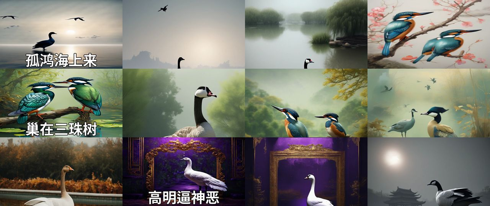
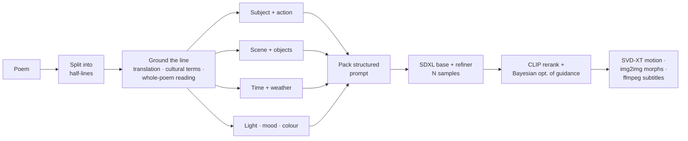

# Poetry to Picture: teaching a machine to see classical Chinese poetry

**▶ [Interactive demo](https://cyrchanh.github.io/undergrad-capstone-poetry-ai-demo/)**. It runs in the browser with nothing to install. You can also clone the repo and open `index.html`.

*HKU BASc Applied AI capstone (graded A+), continued as a funded research assistant role at the HKU Data Science Lab, Dec 2024 – Aug 2025. Hei Chan, technical lead for text-to-video portion.*

A generative pipeline that turns a Tang poem into **illustrated stills, a subtitled motion video, and recitation
coaching** for primary-school students.

| | |
|---|---|
| **+82%** | CLIP image–text score vs. baseline prompting, confirmed by human review |
| **300+** | poems rendered to video as single-command batch jobs on HKU's GPU cluster |
| **4** | parallel ontology analysts per line (GLM-4) |
| **3** | outputs: stills, motion video, recitation feedback |

---

## The problem

Classical Chinese verse is compressed and figurative, and image models read words. A one-shot LLM translation gives a
literal paraphrase. Few-shot prompts handle the examples they were shown, then break on the next poem. For example,
<b>池潢不敢顾</b> isn't "a pond and a moat"; it's a lone goose *not daring to look down*. Diffusion sampling is also
random, so even a good prompt can give a bad image.

## The pipeline

- **Ontology step (the core idea).** Ideas borrowed from RAG (ground each line in retrieved context) and HyDE (generate from a hypothetical *visual description*, not the raw text). Four GLM-4 analysts run concurrently, each filling one slot of a fixed schema under its own hard rules ("list every physical object, with counts", "if a moon is mentioned, it's night", "turn feelings into visible poses"). Subjects carry across lines for continuity.
- **Robustness to randomness.** Several SDXL samples per line, ranked by CLIP, with the guidance scale tuned per line by Bayesian optimisation (range 7–12).
- **Video.** Stable Video Diffusion animates each still. Transitions re-diffuse a cross-fade, with img2img strength peaking mid-morph. ffmpeg burns in subtitles and joins the clips.

## Honest error analysis

The [demo](https://cyrchanh.github.io/undergrad-capstone-poetry-ai-demo/#explore) walks through one real run (Li Bai, 14 half-lines) slot by slot. I sorted the results myself into 5 on target, 5 partial and 4 misses, and traced the misses to their causes:

1. **The judge often never saw the style tag.** CLIP's text encoder stops at 77 tokens. When I re-ran its real tokenizer on the run's prompts, 8 of 14 lost `traditional China`, and on three lines it never saw the setting either. 3 of the 4 misses are in that group, which is suggestive, though 14 lines can't prove it.
2. **Schema text leaked into the prompt.** Phrases the analysts were told never to write ("not further described in terms of appearance or clothing") still appeared, which left subjects with no cultural anchor.
3. **A literal judge, and literal readings.** Even when the whole prompt fits, CLIP rewards a literal match (a bedroom with a window satisfies "gazing across greenery"). Figurative lines like 高明逼神恶 still get drawn literally.

Next steps: front-load style and culture in the prompt, return schema-validated JSON from the analysts, use a multilingual or culture-aware judge, route figurative lines to symbolic depictions, and take poem metadata from the database, not the LLM. GLM-4 once attributed 感遇 to the wrong poet.

## The recitation coach

LLMs can't listen, so the app turns a child's recording into a per-character table an LLM can read:

1. ASR with character timestamps (iFlytek, later Gemini 1.5 Pro)
2. Pause detection on RMS energy. Switching from a median threshold, normalising, and recalibrating the threshold fixed missed pauses
3. Pitch from the dominant FFT frequency
4. Volume, duration, pause and pitch levels for each character, measured relative to the same speaker, following guidance from a recitation researcher at EdUHK
5. Two LLM calls: an expert reading guide for the poem, then feedback comparing the student against it

The web app (Node/Express) marks each character red or green, shows pinyin, tone and a comment on hover, and gives a rhythm score from expected caesurae.
It supports Mandarin and Cantonese, gives feedback in Traditional Chinese, and generates comprehension questions. Scoring is deliberately generous because the users are primary-school children.

## Outcome

- Capstone graded **A+**, then continued as a **funded research assistant** role.
- Scaled generation to **300+ poems** as single-command batch jobs on a shared GPU cluster.
- Led the technical preparation for an **HKSTP seed-funding** pitch. Funding was declined, so the team reassessed the market and chose to stop.

**Stack:** GLM-4 (Zhipu) · SDXL base + refiner · Stable Video Diffusion XT · CLIP ViT-B/32 · bayes_opt · PyTorch / diffusers · ffmpeg · Node/Express · Gemini 1.5 Pro / iFlytek ASR

## About this repository

This is a **public explainer**. Every image and video here is unedited pipeline output. Line translations and verdicts are my own.
The research code is not published. For questions, get in touch via [GitHub](https://github.com/cyrchanh).
